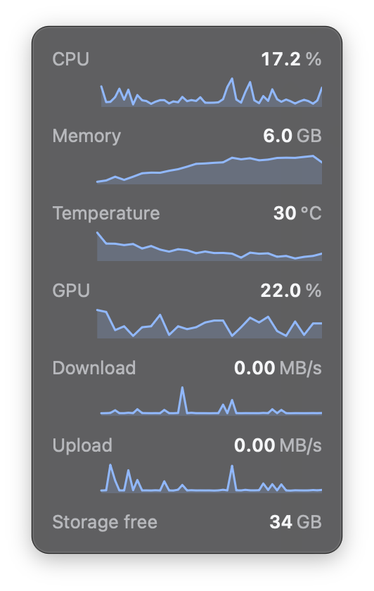
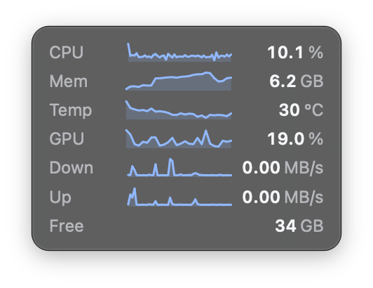
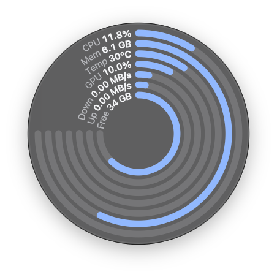

# Excalibur

A small floating window for macOS that shows what your Mac is doing: CPU, memory, temperature, GPU, network and storage, in one place.

<p>
  
  
  
</p>

- **Stays out of the way.** No Dock icon and no menu bar icon; a small window that floats above other windows and starts in the bottom right corner.
- **Four built-in themes:** Frosted, Frosted Compact, Frosted Round and Plain.
- **An accent colour** that follows the one chosen in System Settings, or is picked from a menu.
- **Plugins:** every metric is a small program that prints a number. Add your own by dropping a folder in place.
- **Never asks for a password.** Everything is read without administrator rights.

## Install

On an Apple Silicon Mac running macOS 13 or later, with [Homebrew](https://brew.sh):

```sh
brew install --cask gaberighter/tap/excalibur
```

Then open Excalibur from Applications or Spotlight. To update later:

```sh
brew upgrade --cask excalibur
```

The app is not notarised by Apple. The cask clears the quarantine flag so that it opens.

## Using it

Excalibur has no Dock icon, so everything is in its window.

- **Move it:** drag the window anywhere. It returns to the bottom right corner the next time it starts.
- **Right-click it** for the menu: themes, Accent Color, Reload Plugins, Open Config Folder and Quit Excalibur.
- **Point at a sparkline** to read an earlier value, or at an arc in the round window to see its full name.
- **A dash in place of a value** means the metric could not be read; point at it for the reason. Temperature and GPU readings depend on the Mac.

What the built-in metrics show:

| Metric | Meaning |
|---|---|
| CPU | Share of all cores in use. |
| Memory | Memory in use: app memory, wired and compressed. |
| Temperature | Average of the chip's temperature sensors. |
| GPU | Share of the GPU in use. |
| Download, Upload | Network traffic over Wi-Fi and Ethernet, in megabytes per second. |
| Storage free | Free space on the startup disk. The round window's arc shows how full the disk is. |

## Making it yours

Excalibur needs no configuration. When you want some:

- [Configuration](docs/configuration.md): settings, reordering and hiding metrics, refresh rates.
- [Writing a plugin](docs/plugins.md): add a metric of your own.
- [Writing a theme](docs/themes.md): change the look, the size and the layout.

Your files live in `~/.config/excalibur/`. Choose **Open Config Folder** from the menu to create it.

## Uninstall

```sh
brew uninstall --cask excalibur
```

This leaves `~/.config/excalibur` alone. `brew uninstall --zap --cask excalibur` removes it too.

## Development

Excalibur is written in Rust with [Tauri](https://tauri.app), with a plain HTML, CSS and JavaScript page and no build step for it.

Prerequisites: a current stable Rust toolchain, Xcode Command Line Tools, and the Tauri CLI (`cargo install tauri-cli --version "^2" --locked`).

```sh
cargo tauri dev                                    # run the app from source
cargo test --workspace                             # Rust tests
node --test ui/sparkline.test.js ui/arcs.test.js   # page geometry tests (optional; needs Node)
scripts/build-release.sh                           # build Excalibur.app and a zip of it
```

How it was designed, and why:

- [project_scope.md](project_scope.md): the problem and the solution.
- [decisions.md](decisions.md): every design decision and its reasons.
- [stack.md](stack.md): what it is built with.
- [implementation_plan.md](implementation_plan.md): the order it was built in.
